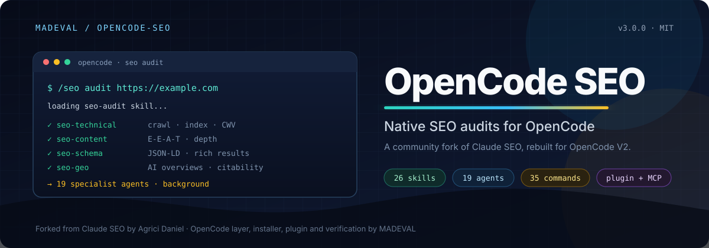

<!--
  OpenCode SEO (opencode-seo): a community fork of Claude SEO by Agrici Daniel.
  Native SEO audits for OpenCode V2, with the canonical Claude Code layer retained.
  Maintained by MADEVAL. MIT licensed.
-->



<h1 align="center">OpenCode SEO</h1>

<p align="center">
  <b>Native SEO audits for <a href="https://opencode.ai">OpenCode V2</a>.</b><br />
  A community fork of <a href="https://github.com/AgriciDaniel/claude-seo">Claude SEO</a> by Agrici Daniel.
</p>

<p align="center">
  <a href="https://github.com/MADEVAL/opencode-seo/actions/workflows/ci.yml"></a>
  <a href="https://opencode.ai"></a>
  <a href="LICENSE"></a>
  <a href="tests/"></a>
  
</p>

<p align="center">
  <a href="#what-this-is">What this is</a> ·
  <a href="#where-it-comes-from">Origin</a> ·
  <a href="#what-we-added">What we added</a> ·
  <a href="#install">Install</a> ·
  <a href="#what-is-inside">What is inside</a> ·
  <a href="#verification">Verification</a> ·
  <a href="#extensions">Extensions</a>
</p>

## What this is

OpenCode SEO is a **community fork of Claude SEO**, rebuilt for OpenCode V2. It keeps the original 26 sub-skills and 19 specialist agents, plus the Python tooling, references and safety checks. The OpenCode layer is new: native skills, agents, slash commands, a local plugin, background subagents, permissions and MCP configuration.

OpenCode is the primary target. Claude Code and other harnesses remain supported through the canonical `skills/`, `agents/`, `hooks/`, `CLAUDE.md` and `AGENTS.md` layout.

This repository is **not** the upstream project. It is maintained by [MADEVAL](https://github.com/MADEVAL).

| | Repository |
|---|---|
| This fork | [MADEVAL/opencode-seo](https://github.com/MADEVAL/opencode-seo) |
| Upstream | [AgriciDaniel/claude-seo](https://github.com/AgriciDaniel/claude-seo) |
| License | MIT, inherited from upstream |

## Where it comes from

- **Original project:** Claude SEO by [Agrici Daniel](https://agricidaniel.com/about), MIT licensed. The SEO methodology, skill bodies, agents, references, Python scripts, schemas and safety rules come from that project.
- **This fork:** the OpenCode V2 adaptation. It adds the generated `.opencode/` target, native commands, a local plugin, an OpenCode installer, an extension installer, MCP wiring, background subagent orchestration and a separate OpenCode test surface.
- **Canonical layer:** `skills/`, `agents/`, `hooks/`, `CLAUDE.md` and `.claude-plugin/` stay in the repository so Claude Code and other harnesses keep working.
- **Upstream demos and results:** videos, screenshots, star history and marketing material from the original project are not copied here as claims about this fork.

## What we added

### OpenCode native layer

- **26 skills** in `.opencode/skills`, with OpenCode frontmatter and relative reference paths.
- **19 agents** in `.opencode/agents`, using `mode: subagent`, `steps` and ordered `permissions`. Agents inherit the session model instead of pinning Anthropic models.
- **35 commands** under `.opencode/commands`, including `/seo`, `/seo/audit`, `/seo/page`, `/seo/technical`, `/seo/schema`, `/seo/sitemap`, `/seo/geo`, `/seo/local`, `/seo/maps`, `/seo/google`, `/seo/drift`, `/seo/setup` and extension commands.
- **Local plugin** `opencode-seo` with the `seo` tool for the managed Python runtime (`run`, `setup`, `doctor`, `path`, `read`), an `execute.after` JSON-LD validation hook, cached interpreter/doctor probes in plugin storage, and a prompt hook that routes a bare `seo <subcommand>` prompt to the matching skill.
- **Native image generation option**: `/seo image-gen` uses OpenCode's `image_generate` tool when available. The banana extension (Gemini via nanobanana-mcp) remains a fully supported alternative for exact aspect presets, 2K/4K output, thinking level, and multi-image references.
- **Task tracking and delegation limits**: `experimental.todo` for multi-step audits and `experimental.subagent_depth: 1` so specialists cannot fan out further.
- **Background subagent protocol** for audits: launch independent specialists together, collect reports as they arrive, keep partial findings, and fall back to inline work when a child cannot start.

### Runtime and installation

- `install-opencode.sh` and `install-opencode.ps1` install skills, agents, commands, plugin and the isolated Python runtime.
- `extensions/install-opencode.sh` and `extensions/install-opencode.ps1` install extension skills, agents and `mcp.servers` entries.
- OpenCode credentials use `~/.config/opencode-seo` and caches use `~/.cache/opencode-seo`. Existing Claude files are read as a fallback, so an upgrade does not lose Google, Matomo, Moz, Bing or Common Crawl credentials.
- The `seo` tool uses `ctx.location.directory`, so worktrees, moved sessions and multi-location servers write audit artifacts to the right project.
- Permission denials propagate as `Tool.Error` instead of being returned as ordinary tool output.

### Reliability

- Windows credential files get an explicit current-user ACL grant before inheritance is removed.
- Matomo is treated as a REST API, not an MCP server.
- Extension commands tell the user which extension to install when its skill is missing.
- The generator has regression checks for `seo run run`, legacy credential paths, vendor-matrix content and cross-skill references.
- The full test suite covers 2372 passing tests, with 33 platform-specific skips on this Windows machine.

## Install

### Requirements

- OpenCode V2. This fork is verified on OpenCode **2.2.7**.
- Python **3.11 to 3.14**.
- Node.js 20 or newer only when you install an MCP extension.
- Git when you clone the repository.

### OpenCode, Unix

```bash
git clone https://github.com/MADEVAL/opencode-seo.git
cd opencode-seo
./install-opencode.sh
```

### OpenCode, Windows PowerShell

```powershell
git clone https://github.com/MADEVAL/opencode-seo.git
cd opencode-seo
.\install-opencode.ps1
```

Set `OPENCODE_CONFIG_DIR` to install somewhere other than `~/.config/opencode`:

```bash
OPENCODE_CONFIG_DIR=/opt/opencode ./install-opencode.sh --no-setup
```

Then use:

```text
/seo
/seo/audit https://example.com
/seo/page https://example.com
/seo/technical https://example.com
@seo
```

### Verify the installation

```bash
opencode plugin list
opencode debug agents
opencode debug config
opencode mcp list
```

Expected on a clean install:

- `opencode-seo` appears in `opencode plugin list`;
- 19 `seo-*` agents appear in `opencode debug agents`;
- 26 skills are discovered under `.opencode/skills` or `~/.config/opencode/skills`;
- `/seo` and `/seo/audit` are available in the command list.

If the runtime is not ready yet:

```text
/seo setup
```

Or run:

```bash
python ~/.config/opencode/opencode-seo/scripts/runtime.py setup
```

### Claude Code and other harnesses

The original Claude Code installation paths still work:

```bash
git clone https://github.com/MADEVAL/opencode-seo.git
bash opencode-seo/install.sh
```

Claude Code reads `CLAUDE.md`, `skills/`, `agents/`, `hooks/` and `.claude-plugin/`. Cursor, Codex, Cline, Aider and Antigravity read `AGENTS.md` and `skills/`. The upstream Claude Code marketplace install is documented by the original project.

## What is inside

| Component | Count | Location |
|---|---:|---|
| SEO skills | 26 | `skills/`, generated to `.opencode/skills/` |
| Specialist agents | 19 | `agents/`, generated to `.opencode/agents/` |
| OpenCode commands | 35 | `.opencode/commands/` |
| Python scripts | 68 | `scripts/` |
| Extensions | 9 | `extensions/` |
| Tests | 2372 passing | `tests/` |

The skills cover technical SEO, Core Web Vitals, E-E-A-T and content quality, Schema.org, sitemaps, image SEO, GEO and AI search, local SEO, maps, backlinks, Google APIs, e-commerce, international SEO, drift monitoring, content clustering, SXO, programmatic SEO, competitor pages, the FLOW framework and agent readiness.

## How an audit works

1. **Load the skill.** `/seo/audit` loads `seo-audit` and the main `seo` router.
2. **Render and crawl.** The runtime fetches pages with SSRF protection and uses Playwright when a page needs JavaScript.
3. **Launch specialists.** The orchestrator starts technical, content, schema and other relevant agents with the `subagent` tool. Children run in the background.
4. **Merge findings.** Each specialist writes partial findings under `{domain}-audit/findings/`.
5. **Report.** The parent merges the evidence into a scored report, an action plan and optional PDF or JSON artifacts.

Reports stay on your machine. Optional extensions can call third-party APIs when you provide your own credentials.

## Verification

Run the same checks locally:

```bash
python scripts/build_opencode.py --check
.venv/Scripts/python.exe -m pytest tests -q
opencode plugin list
opencode debug agents
opencode mcp list
```

Last verification in this repository:

```text
python scripts/build_opencode.py --check
OpenCode target is up to date.

.venv\Scripts\python.exe -m pytest tests -q
2372 passed, 33 skipped

opencode plugin list
opencode-seo  local

opencode debug agents
19 seo-* agents, mode: subagent

opencode debug config
permissions and subagent_depth present, no duplicate instructions

opencode mcp list
No MCP servers configured
```

The `seo` tool was also exercised directly through the bundled plugin harness:

```text
path: D:/_DEV/_SKILLS/opencode-seo
run-status: 200 title: Example Domain
read-bytes: 10015
permission-propagated: true
hooks: execute.after
hook-result: schema validation placeholder warning
```

## Compatibility and limits

- **OpenCode:** native target, verified on 2.2.7.
- **Claude Code:** canonical layer retained, not removed.
- **Other harnesses:** `AGENTS.md` and `skills/` remain readable.
- **Models:** OpenCode agents inherit the session model. Claude agents keep the original model presets.
- **Runtime:** Python 3.11 to 3.14. `seo setup` creates an isolated environment and does not install packages globally.
- **Network:** Core Web Vitals are lab estimates when Google API credentials are not configured. Indexing data is inferred from the page.
- **Extensions:** optional. The core audit works without them.

## Extensions

Optional add-ons, installed separately:

- **DataForSEO:** live SERP, keyword, backlink and business data.
- **Firecrawl:** full-site crawling and site maps.
- **Banana:** AI image generation for SEO assets.
- **Ahrefs:** backlink and keyword data.
- **SE Ranking:** AI share of voice.
- **Profound:** LLM citation tracking.
- **Bing Webmaster:** Bing data and IndexNow submission.
- **Matomo:** self-hosted analytics reports.
- **Unlighthouse:** multi-page Lighthouse audits.

```bash
./extensions/install-opencode.sh dataforseo --username me@example.com --password secret
./extensions/install-opencode.sh firecrawl --key fc-...
./extensions/install-opencode.sh matomo --url https://analytics.example.com --key token --site-id 1
```

See [docs/OPENCODE-MCP.md](docs/OPENCODE-MCP.md) for MCP details.

## Repository layout

```text
skills/             Canonical portable skills, Claude compatible
agents/             Canonical Claude-compatible agents
hooks/              Claude hooks plus the shared schema validator
.claude-plugin/     Claude plugin manifest
.opencode/          Generated OpenCode target, committed
opencode/           OpenCode command and plugin sources
scripts/            Python runtime, installers and tooling
extensions/         Optional MCP and data extensions
docs/               Installation, MCP, commands, architecture and port notes
tests/              Full test suite
```

Regenerate the OpenCode target after changing canonical skills or agents:

```bash
python scripts/build_opencode.py
python scripts/build_opencode.py --check
```

## Docs

- [OpenCode installation](docs/OPENCODE-INSTALL.md)
- [OpenCode MCP and extensions](docs/OPENCODE-MCP.md)
- [Commands](docs/COMMANDS.md)
- [Architecture](docs/ARCHITECTURE.md)
- [Troubleshooting](docs/TROUBLESHOOTING.md)
- [Port plan and verification](docs/OPENCODE-PORT-PLAN.md)
- [Security](SECURITY.md)
- [Privacy](PRIVACY.md)
- [Contributors](CONTRIBUTORS.md)

## Credits and license

- **Upstream author:** Agrici Daniel, creator of Claude SEO.
- **Fork maintenance:** MADEVAL, OpenCode V2 adaptation.
- **Community contributions:** see [CONTRIBUTORS.md](CONTRIBUTORS.md).
- **License:** MIT. See [LICENSE](LICENSE).

Contributions are welcome. Read [CONTRIBUTING.md](CONTRIBUTING.md) first and include the checks you ran in your pull request.
